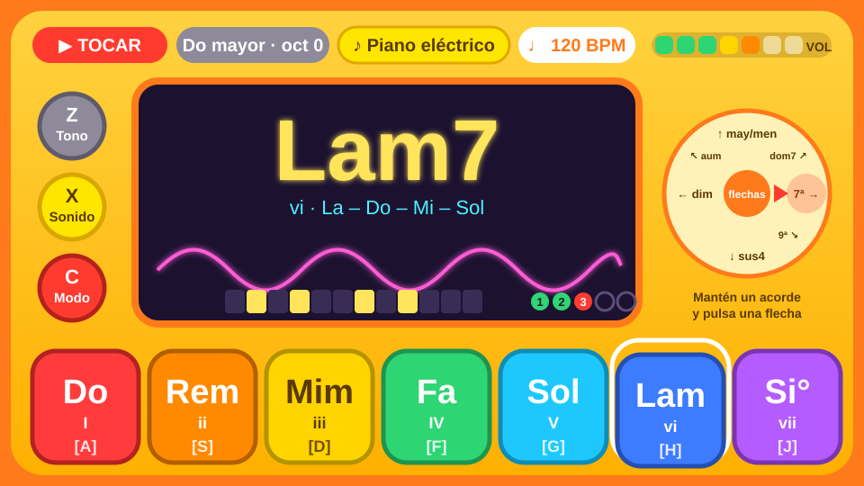

# Mapachsynthesizer 🦝🎹

Sintetizador para niños, escrito en Rust, para Linux. Se toca con el teclado del ordenador
y una perilla, y su interfaz de colores vivos está inspirada en el
[HiChord](https://updater.hichord.shop/manual/) y en el M-VAVE FM-1.



Con él se puede:

- Tocar **acordes que siempre suenan bien** con 7 teclas y cambiarles el "color" con las flechas.
- Elegir entre muchos **sonidos** (analógico, FM, samples) y **efectos** (eco, distorsión, robot…).
- Hacer **ritmos** y **arpegios** con el tempo controlado por la perilla.
- Grabar capas en un **looper de 6 pistas**.
- Grabar su voz y **destrozar samples** en el taller.
- **Guardar** canciones y **exportarlas a MP3, OGG o WAV**.

## Estado

🎹 **Ya se puede tocar.** Están hechas las fases 0, 1, 2 y 4 del [plan](docs/plan.md#5-fases-y-entregables):

- Los 7 acordes de colores con voice leading, las flechas y la perilla mágica para cambiarles el
  color, y la fila `Q`…`U` una octava más aguda.
- Menús gris (tono), amarillo (sonido) y rojo (modo). Se abren al pulsar y soltar; si se mantienen,
  hacen atajos con las flechas y las perillas, y con `Espacio` ponen valores al azar 🎲.
- 8 sonidos de analógico virtual, con ataque, release y brillo.
- Modos Tocar, Rasgueo, Arpegio (6 patrones), Repetir, Zumbido y Melodía, con tempo y tap tempo (`B`).
- El mando de 16 teclas y 3 perillas, leído por `evdev` en exclusiva.
- Limitador a −12 dBFS al final de todo y ajustes que se guardan solos.
- Modo papá (`Ctrl+Alt+P`), el único sitio desde donde se sale (`Q`).

**Falta:** el asistente "Aprender mando", batería, looper, canciones y exportar, más motores de
sonido, efectos, taller de samples y paquetes.

## Compilar y tocar

Hace falta Rust (1.88 o más nuevo) y las cabeceras de ALSA:

```bash
sudo dnf install alsa-lib-devel          # Fedora
sudo apt install libasound2-dev          # Ubuntu / Debian

cargo run --release -p mapach-app                # pantalla completa
cargo run --release -p mapach-app -- --ventana   # en una ventana
```

| Tecla | Qué hace |
|---|---|
| `A S D F G H J` | Acordes (`Q`…`U`, una octava más aguda) |
| Flechas | Mientras suena un acorde, cambian su color |
| `Z` `X` `C` | Menús de tono, sonido y modo |
| `RePág` / `AvPág` | Volumen (perilla 1) |
| Rueda del ratón | Perilla mágica (2) |
| `-` / `+` | Tempo (perilla 3) |
| `B` | Tap tempo |
| `Ctrl+Alt+P` | Modo papá (salir con `Q`) |

Para depurar sin sonido: `mapach-app --ventana --captura salida.ppm --demo 1` guarda una captura
de la pantalla (escenas 0–6).

### Documentos

- [Investigación](docs/investigacion.md): qué hacen el HiChord y el FM-1, la perilla de AliExpress y las crates de Rust, y los firmwares de la comunidad del FM-1 (fm1-chord, Rainbow mode).
- [Plan](docs/plan.md): principios, mapa de teclas, funciones, arquitectura, fases y preguntas abiertas.
- [Mando](docs/mando.md): mapeo del macropad de 16 teclas y 3 perillas. Ya está programado con [`herramientas/mando.py`](herramientas/mando.py).
- [Bocetos](docs/bocetos/README.md): todas las pantallas.
