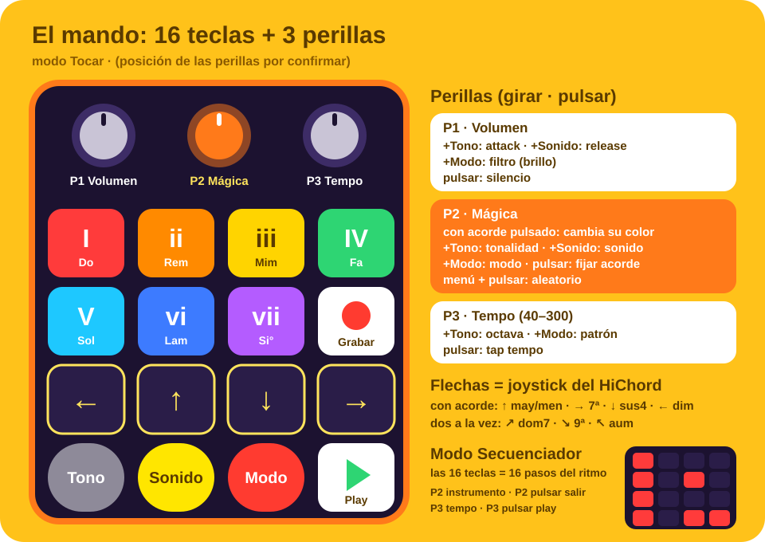

# El mando: macropad de 16 teclas y 3 perillas

**Modelo elegido:** [teclado macro de 16 teclas y 3 perillas (AliExpress)](https://es.aliexpress.com/item/1005010043319280.html)

- 16 teclas en rejilla 4×4 y 3 perillas. Cada perilla tiene 3 acciones: girar a la izquierda,
  girar a la derecha y pulsar.
- 3 capas con indicador LED, RGB, base de silicona antideslizante.
- Cable USB-C, Bluetooth y 2,4 GHz. En inalámbrico apaga las luces.
- El fabricante lo configura con un programa de Windows y la configuración queda guardada en el
  teclado. **No tenemos Windows**, así que lo programamos desde Linux (ver
  [Configuración sin Windows](#configuración-sin-windows-)).
- Un comprador lo usa en Photoshop con las perillas para zoom y tamaño de pincel. Eso confirma
  que las perillas pueden mandar cualquier tecla, no solo el volumen.

**Por qué este y no el de 12 teclas y 4 perillas:** con 16 teclas caben las 4 flechas del
joystick (como el HiChord de verdad) y además el **secuenciador de 16 pasos se toca directamente**,
una tecla por paso. La cuarta perilla no hace falta, porque el filtro pasa a "volumen + botón rojo",
que es como lo hace el HiChord.



> Confirmado con el mando real: las perillas están arriba, como en el boceto.

---

## Mapeo en modo Tocar

### Teclas

| | 1 | 2 | 3 | 4 |
|---|---|---|---|---|
| **Fila 1** | Acorde **I** (rojo) | Acorde **ii** (naranja) | Acorde **iii** (amarillo) | Acorde **IV** (verde) |
| **Fila 2** | Acorde **V** (cian) | Acorde **vi** (azul) | Acorde **vii** (morado) | ● **Grabar** |
| **Fila 3** | ⚡ Atajo 1 | ⚡ Atajo 2 | ⚡ Atajo 3 | ⚡ Atajo 4 |
| **Fila 4** | **Tono** (gris) | **Sonido** (amarillo) | **Modo** (rojo) | **OK** (verde) |

- **Atajos (fila 3):** cada tecla dispara un sample entero, que también se graba en el looper.
  Se configuran en el Taller: con un sonido elegido, mantén el botón amarillo y pulsa el atajo.
  (Antes eran las flechas; su trabajo lo hace ahora la rueda grande.)
- **OK (verde):** el botón central de la rueda, como en un iPod. En un menú entra y sale de cambiar
  el valor; en Canciones abre o exporta; en el Taller, mantenido con la rueda, elige el destrozo y
  al soltarlo lo aplica. Fuera de eso, sigue y para el looper y el ritmo.
- **Menús:** si mantienes Tono, Sonido o Modo y giras la rueda grande, cambias la tonalidad, el
  sonido o el modo.
- **Grabar:** empieza y para la grabación de la pista elegida del looper.
- En **modo Batería**, las 7 teclas de acorde tocan los 7 golpes del kit.

### Perillas

| Perilla | Girar | Pulsar |
|---|---|---|
| **Izquierda · Volumen** | Volumen. Con Tono, Sonido o Modo pulsado: ataque, release o brillo | Silencio. Con la vista de loops: silencia la pista elegida |
| **Centro · Tempo** | BPM (40–300). Con Tono pulsado: octava; con Sonido: cantidad de efecto; con Modo: patrón o ritmo | Tap tempo. Con la vista de loops: borra la pista elegida (dos pulsaciones) |
| **Derecha, la grande · Rueda-cursor** | Ver abajo | Abre y cierra la vista de loops |

La **rueda grande funciona como la de un iPod**:

- **Mantener un botón de abajo y girar** elige: Tono → tonalidad, Sonido → sonido, Modo → modo,
  Play → pista del looper.
- **En un menú abierto** (pulsar y soltar Tono, Sonido o Modo): girar mueve el cursor por las
  opciones; **Play** entra a cambiar el valor (entonces girar lo cambia) y Play otra vez sale.
- **Con un acorde pulsado**: recorre sus colores (normal → mayor/menor → 7ª → 7ª dominante → 9ª →
  sus4 → disminuido → aumentado).
- **En Canciones y en el Taller**: mueve la selección; Play elige (abrir, exportar o destrozar).
- **Con la vista de loops abierta**: elige la pista.
- **En el secuenciador**: elige el instrumento.

Play actúa al soltarlo, para poder combinarlo con la rueda sin que arranque el looper.

---|---|---|---|---|---|
| **P1 · Volumen** | Volumen | Attack | Release | **Filtro** (brillo) | Silencio |
| **P2 · Mágica** | Con un acorde pulsado: va pasando por sus colores. Si no, navega | Tonalidad | Sonido | Modo | Con acorde: **fijarlo** (chord lock). Con menú: 🎲 aleatorio |
| **P3 · Tempo** | BPM (40–300) | Octava | Cantidad de efecto | Patrón de arpegio o ritmo | Tap tempo |

Orden de colores con P2: normal → mayor/menor → 7ª → 7ª dominante → 9ª → sus4 → disminuido →
aumentado → (vuelta a normal). Sirve para que los más pequeños, a los que les cuesta combinar
flechas, también puedan cambiar el color.

---

## Mapeo en modo Secuenciador (batería)

Las **16 teclas son los 16 pasos del ritmo**: pulsas y el paso se enciende o se apaga.
La pantalla muestra la rejilla y la fila del instrumento elegido.

| Control | Función |
|---|---|
| Teclas 1–16 | Encender o apagar el paso |
| P2 girar | Elegir instrumento (bombo, caja, charles…) |
| P2 pulsar | Salir del secuenciador. El patrón se graba solo en una pista libre del looper |
| P3 girar | Tempo |
| P3 pulsar | Play / pausa |
| P1 | Volumen, como siempre |

---

## Capas del mando

Los modos los gestiona la app, así que **las 3 capas se programan iguales**: si el niño cambia de
capa sin querer, no pasa nada. Más adelante se podrían usar la capa 2 para el looper y la capa 3
para el taller de samples.

---

## Configuración sin Windows ✅

**Hecho el 17-11-2026.** El mando está programado y comprobado.

### Lo que encontramos al conectarlo

- **ID USB `514c:8850`**, no `1189:8890` como esperábamos. Por eso `ch57x-keyboard-tool` **no sirve**:
  este chip usa otro protocolo.
- Aparece como **dos interfaces**: la 0 es la de configuración (`hidraw`, informe 3 de 64 bytes) y
  la 1 crea dos dispositivos de entrada, "Keyboard" y "Mouse".
- **De fábrica** las 25 acciones mandaban las letras `a`…`y`, una distinta cada una. Se guardaron en
  [`config/mando-fabrica.json`](../config/mando-fabrica.json) por si hay que volver a ellas.
- **Las perillas están arriba.** El firmware numera las teclas **por columnas, de abajo arriba**
  (la ranura 1 es la de abajo a la izquierda). La herramienta lo traduce para que la tecla 1 sea
  la de arriba a la izquierda, como en las tablas de arriba.
- Cada perilla manda 3 códigos distintos: girar a la izquierda, girar a la derecha y pulsar.
  Un clic de giro manda una pulsación. Ojo: en el firmware cada perilla va en el orden
  **derecha, pulsar, izquierda** (al revés de lo que dice la herramienta de la que sale el
  protocolo). Comprobado girando cada perilla.

### Cómo se programa

[`herramientas/mando.py`](../herramientas/mando.py) no necesita nada instalado: solo Python y la
regla udev. El protocolo sale de [macropad-16key-3knob](https://github.com/elmitash/macropad-16key-3knob)
(MIT).

```bash
# Una vez: permisos para usar el mando sin sudo (después, desenchufar y enchufar)
sudo cp config/70-mapachsynthesizer-mando.rules /etc/udev/rules.d/
sudo udevadm control --reload-rules && sudo udevadm trigger

python3 herramientas/mando.py leer -o copia.json  # ver y guardar lo que tiene grabado
python3 herramientas/mando.py escribir            # grabar el mapeo de Mapachsynthesizer y comprobarlo
python3 herramientas/mando.py probar              # ver en vivo qué manda cada control (Ctrl+C)
```

La configuración se guarda en el mando: no hay que repetirla en otros ordenadores.

### Códigos grabados

Sin modificadores, y las 3 capas iguales:

| Control | Código |
|---|---|
| Teclas 1–12 | `F13` … `F24` |
| Teclas 13–16 | Teclado numérico `1` `2` `3` `4` |
| P1 derecha / izquierda / pulsar | Num `5` / `6` / `7` |
| P2 derecha / izquierda / pulsar | Num `8` / `9` / `0` |
| P3 derecha / izquierda / pulsar | Num `/` / `*` / `-` |

> Comprobado tocando: el primer código de cada perilla llega al girarla **a la derecha**. La app ya
> lo tiene en cuenta; si algún día gira al revés, el asistente "Aprender mando" lo arregla.

> **Ojo:** con Mapachsynthesizer cerrada, en Fedora/GNOME las teclas 8–11 (`F20`–`F23`) pueden silenciar el
> micrófono o activar y desactivar el touchpad. Con Mapachsynthesizer abierta no pasa, porque la app coge el
> mando en exclusiva.

## Cómo lo lee la app

1. **`evdev` + acceso exclusivo (`EVIOCGRAB`).** La app abre el mando directamente. Mientras está
   abierta, sus pulsaciones no llegan al escritorio, así que no escriben en otras ventanas ni
   cambian el volumen del sistema.
2. **Se identifica por dispositivo**, así que no importa si sus códigos coinciden con teclas del
   teclado normal: los dos funcionan a la vez sin pisarse.
3. **Asistente "Aprender mando"** (la primera vez o desde el modo papá). La pantalla pide
   *"pulsa la tecla roja"*, *"gira la perilla 1 a la derecha"*… y guarda el resultado en
   `mando.ron`. Si un código se repite, avisa.
4. **Permisos:** la regla [`config/70-mapachsynthesizer-mando.rules`](../config/70-mapachsynthesizer-mando.rules) da acceso
   sin `sudo` al mando (`514c:8850`), tanto para leerlo (`input`) como para programarlo (`hidraw`).
   Ya está instalada en este ordenador.
5. Si se desconecta el mando, la app sigue funcionando con el teclado normal y lo vuelve a coger
   solo cuando se reconecta.

## Recomendaciones

- **Usarlo por cable.** Tiene menos latencia, no gasta batería y las luces siguen encendidas.
- **Teclas de colores.** Si las teclas son estándar (MX), poner teclas o pegatinas iguales a la
  pantalla: arcoíris en los acordes, negro con flecha amarilla en las flechas, gris/amarillo/rojo
  en los menús y blanco en Grabar y Play.
- **RGB:** si permite color fijo, ponerlo suave o apagado para que no compita con las teclas de colores.
